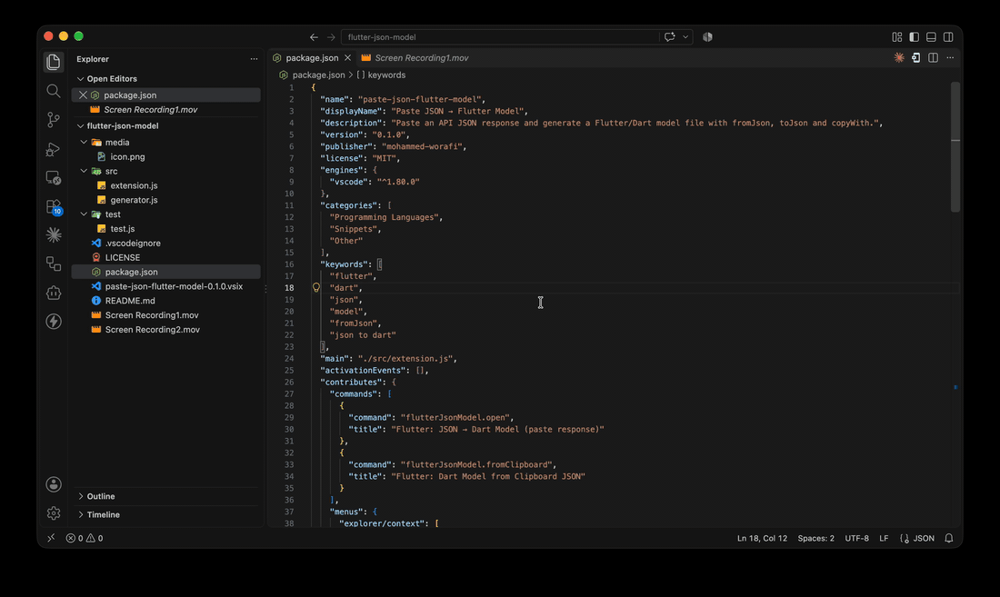
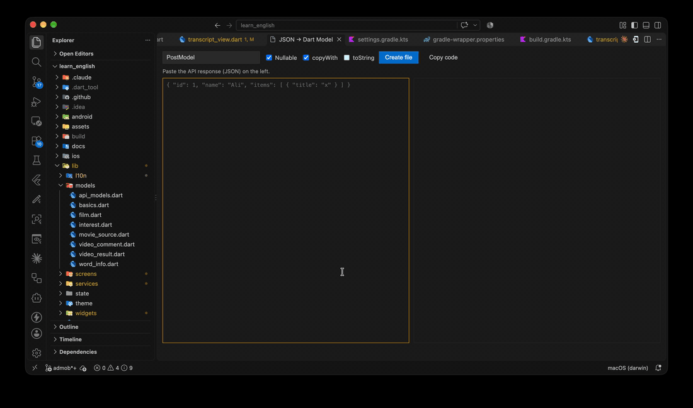
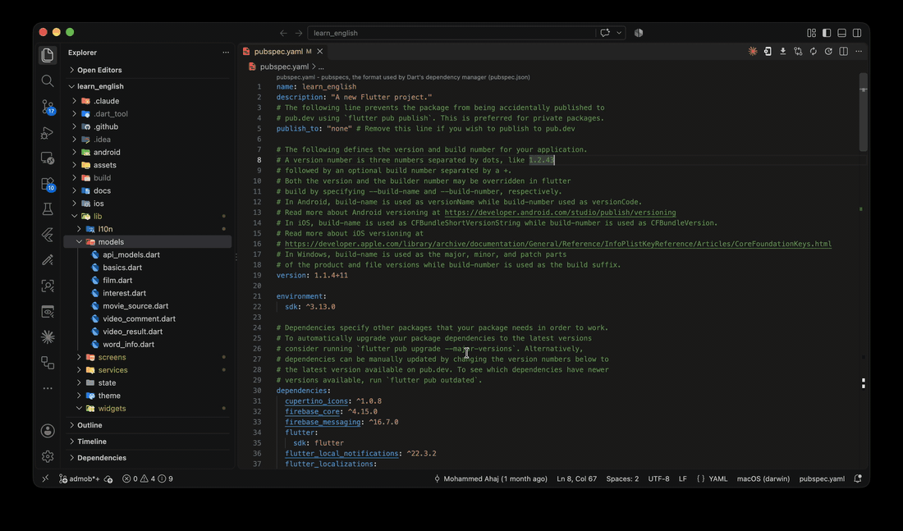

# Paste JSON → Flutter Model

**Turn any API response into a ready-to-use Flutter / Dart model in seconds.**
Paste the JSON, type a class name, click **Create file** — you get a clean, null-safe model with `fromJson`, `toJson` and `copyWith`, including every nested object and list.

No setup, no `build_runner`, no extra packages in your `pubspec.yaml`.

---

## ✨ Demo

### 1. Paste the response — live preview as you type


### 2. Name the class and click **Create file**


### 3. The model file is created in your project and opened


---

## 🚀 Features

- **Live preview** — the Dart code updates while you paste or edit the JSON.
- **Nested objects → separate classes** — `"orders": [ {...} ]` becomes a `List<Order>` with its own `Order` class.
- **Smart list handling** — lists of primitives, lists of objects, and nested lists (`List<List<int>>`).
- **Merges array items** — fields from *all* items of an array are combined, so optional keys aren't lost.
- **Correct number types** — a field that is `10` in one item and `12.5` in another becomes `double` and is parsed safely with `(json['x'] as num?)?.toDouble()`.
- **Dart naming conventions** — `user_id` → `userId`, `full-name` → `fullName`, while the original JSON keys are kept in `fromJson`/`toJson`.
- **Reserved words handled** — keys like `class`, `default` or `new` become `classValue`, `defaultValue`, …
- **Null safety** — nullable fields by default (safest for real APIs), or non-nullable with `required` constructor params.
- **Optional extras** — `copyWith` and `toString` with one click.
- **Root arrays supported** — paste `[ {...}, {...} ]` and the item model is generated.
- **Zero dependencies** — the generated code is plain Dart; nothing to add to `pubspec.yaml`.

## 📦 Example

**Input**

```json
{
  "id": 1,
  "full_name": "Ali",
  "rating": 4.5,
  "tags": ["flutter", "dart"],
  "orders": [
    { "id": 10, "total": 25 },
    { "id": 11, "total": 12.5, "note": "gift" }
  ]
}
```

**Output** (`user_model.dart`)

```dart
class UserModel {
  final int? id;
  final String? fullName;
  final double? rating;
  final List<String>? tags;
  final List<Order>? orders;

  const UserModel({this.id, this.fullName, this.rating, this.tags, this.orders});

  factory UserModel.fromJson(Map<String, dynamic> json) => UserModel(
        id: json['id'] as int?,
        fullName: json['full_name'] as String?,
        rating: (json['rating'] as num?)?.toDouble(),
        tags: (json['tags'] as List<dynamic>?)?.map((e) => e as String).toList(),
        orders: (json['orders'] as List<dynamic>?)
            ?.map((e) => Order.fromJson(e as Map<String, dynamic>))
            .toList(),
      );

  Map<String, dynamic> toJson() => {
        'id': id,
        'full_name': fullName,
        'rating': rating,
        'tags': tags,
        'orders': orders?.map((e) => e.toJson()).toList(),
      };

  // + copyWith(...)
}

class Order {
  final int? id;
  final double? total;
  final String? note;
  // + constructor, fromJson, toJson, copyWith
}
```

## 🛠 How to use

| Way | Steps |
|---|---|
| **Panel** | Press **`Cmd+Alt+J`** (macOS) / **`Ctrl+Alt+J`** (Windows/Linux), or run **“Flutter: JSON → Dart Model (paste response)”** from the Command Palette. Paste the JSON, set the class name, click **Create file**. |
| **Explorer** | Right-click a folder (e.g. `lib/models`) → **Flutter: JSON → Dart Model**. The file is created inside that folder. |
| **Clipboard (fastest)** | Copy the API response → run **“Flutter: Dart Model from Clipboard JSON”** → enter the class name. Done. |

The file name is generated from the class name in `snake_case` (`PostModel` → `post_model.dart`).
If no folder is selected, the file goes to `lib/models` (configurable).

## ⚙️ Settings

| Setting | Default | Description |
|---|---|---|
| `flutterJsonModel.defaultFolder` | `lib/models` | Folder (relative to the workspace root) used when no folder is selected. |
| `flutterJsonModel.nullableFields` | `true` | Make all fields nullable. Turn off to get non-nullable fields with `required` params (fields missing from some items stay nullable). |
| `flutterJsonModel.copyWith` | `true` | Generate a `copyWith` method. |
| `flutterJsonModel.toString` | `false` | Generate a `toString` override. |

---

## 🇸🇦 بالعربي

إضافة تحوّل الـ **JSON Response** من أي API إلى **Model** جاهز في Flutter خلال ثوانٍ:

1. اضغط `Cmd+Alt+J` والصق الريسبونس.
2. اكتب اسم الكلاس وشاهد الكود مباشرة.
3. اضغط **Create file** ويتم إنشاء الملف داخل `lib/models` (أو المجلد الذي اخترته بالزر الأيمن).

يدعم الكائنات المتداخلة، والقوائم، والـ null safety، و`copyWith`، بدون أي مكتبات إضافية.

---

## 📝 License

MIT
